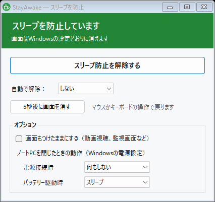
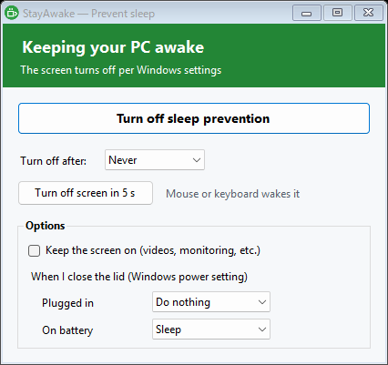

# StayAwake — スリープを防止

Windowsの無操作によるスリープを防ぐ、小さなデスクトップアプリです。
インストール不要。`StayAwake.exe` を起動するだけで使えます。

[English](README.en.md) · [ダウンロード / Releases](https://github.com/mamesiva64/stay-awake/releases/latest) · [リリースノート](RELEASE_NOTES.md) · [MIT License](LICENSE)



## ダウンロードと使い方

1. [Releases](https://github.com/mamesiva64/stay-awake/releases/latest) から `StayAwake-1.1.0-windows.zip` をダウンロードし、展開します。
2. `StayAwake.exe` を起動します。起動するとすぐにスリープ防止が始まります。画面はWindowsの設定どおりに消えます。
3. 上部のボタンでスリープ防止のオン・オフを切り替えます。「自動で解除」で、しない・30分後・1時間後・2時間後・4時間後・8時間後から選べます。
4. 「5秒後に画面を消す」を押すと、5秒後に画面を消します。マウスかキーボードを操作すると戻ります。カウントダウン中にもう一度押すと中止します。
5. ウィンドウを閉じると確認メッセージが表示され、OKで終了します。終了するとスリープ防止は解除されます。カバーを閉じたときの動作は、今の設定のまま残ります。

対応環境：Windows 10 / 11、.NET Framework 4.x。通常、Windows付属の環境で動作し、追加インストールは不要です。
配布EXEはコード署名されていません。

## オプション

| 項目 | 動作 |
| --- | --- |
| 画面もつけたままにする | 初期状態はオフ。オンにすると、画面が自動で消えるのも防ぎます。オフのときは、画面はWindowsの設定どおりに消えます。 |
| ノートPCを閉じたときの動作 | Windowsの「カバーを閉じたときの動作」を、電源接続時・バッテリー駆動時の別々に表示・変更します。 |

### ノートPCを閉じたときの動作について

Windowsの電源オプションと同じように、「電源接続時」「バッテリー駆動時」それぞれのコンボボックスで「何もしない」「スリープ」「休止状態」「シャットダウン」から選べます。
表示は**Windowsの現在の設定**をそのまま反映します。起動しただけでは設定を変更しません。
「休止状態」は、そのPCで休止状態が使える場合だけ表示します（Windowsが休止状態に設定されている場合は、使えなくてもそのまま表示します）。
設定は定期的に読み直すため、Windows側で電源プランや設定を変えると画面にも反映されます。

ノートPCを閉じてもスリープさせたくない場合は「何もしない」を選んでください。

- 選び直すと確認ダイアログが表示され、「はい」で選んだ側（電源接続時またはバッテリー駆動時）だけ変更します。もう一方の設定は変更しません。
- 「いいえ」を押すと変更せず、表示もWindowsの現在の設定に戻ります。
- **変更前の設定や復元用のファイルは保存しません。** 別のPCへアプリをコピーしても、そのPCのWindowsの設定を読み取ります。
- **変更した設定は、スリープ防止の解除・自動解除・アプリ終了後もそのまま残ります。** 戻す場合は、このアプリかWindowsの電源オプションで選び直してください。
- 変更に失敗した場合はエラーを表示し、Windowsの設定を読み直します。自動では元に戻しません。

旧試作版の `%LOCALAPPDATA%\StayAwake` にある `initial-*.txt` / `pending.txt` は、このバージョンでは読み書きしません。旧版を終了してから使用してください。旧ファイルの内容が別PCへ適用されることはありません。

スリープ防止そのものは、Windowsの電源設定を書き換えません。Windowsの設定を変更するのは「ノートPCを閉じたときの動作」だけで、必ず確認してから変更します。
権限や組織のポリシーによって変更できない場合があります。手動でのスリープ・シャットダウンや、Windows・機器側の保護動作は防止しません。

## 日本語 / English

Windowsの表示言語が日本語なら日本語、それ以外なら英語を自動選択します。ボタン、状態表示、確認ダイアログも切り替わります。
次の起動引数で明示的に選択することもできます。

```powershell
.\StayAwake.exe --lang=ja
.\StayAwake.exe --lang=en
```



## ソースからビルド

Windows PowerShellで実行します。Windows付属の .NET Framework C#コンパイラーを使用し、Visual StudioやNuGetパッケージは不要です。

```powershell
powershell -NoProfile -ExecutionPolicy Bypass -File .\build.ps1
powershell -NoProfile -ExecutionPolicy Bypass -File .\test.ps1
```

- `StayAwake.cs`：画面、日英表示、スリープ防止、自動解除、画面を消す機能
- `LidSettings.cs`：Windowsの「カバーを閉じたときの動作」の読み書き（設定ファイルなし）
- `Tests.cs`：疑似電源設定での確認・キャンセル・失敗・自動解除・画面を消す・終了確認・言語切替のテスト
- `build.ps1`：アイコン生成と実行ファイルのビルド
- `test.ps1`：テストのビルドと実行。実機の電源設定は変更しません。

スクリーンショットを再生成する場合は、テストのビルド後に `.\Tests.exe --screenshots .\docs` を実行します。画面には実機のWindowsの設定を読み取って表示するだけで、電源設定は変更しません。

## ライセンス

[MIT](LICENSE)。改変・再配布・商用利用が可能です。
